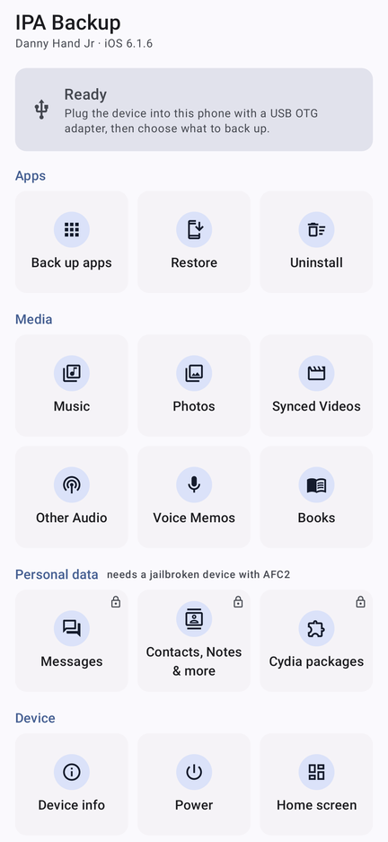
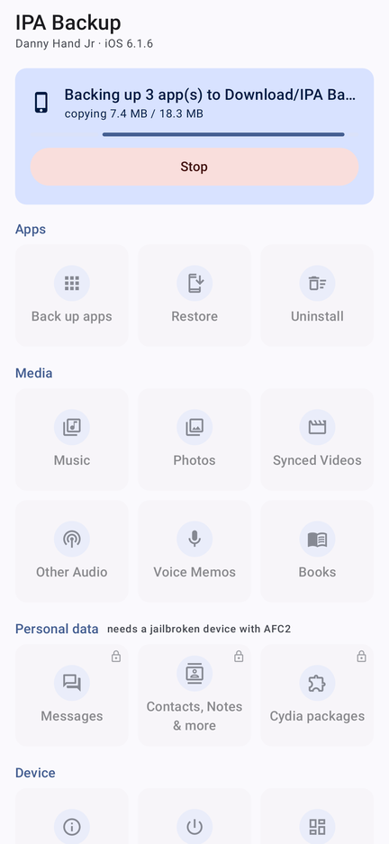
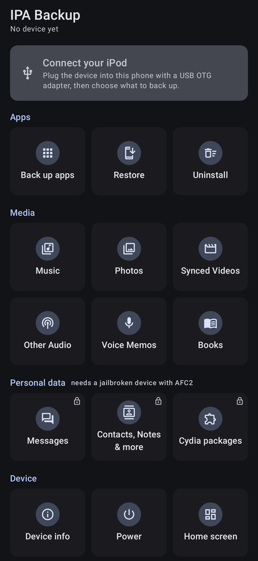

# IPA Backup (Android app)

Back up the apps on an old iPod Touch, iPhone or iPad to your Android phone over a USB cable,
with no computer, no root on the phone, and no jailbreak needed on the iOS device. See Device support 
section below for which iOS versions are supported.

Built to rescue App Store games that are long gone from the store, from an iPod Touch 4th gen on iOS 6.1.6.

## Disclaimer

**Use at your own risk.** This software is provided "as is", without warranty of any kind, express or
implied. It talks to your device using undocumented Apple protocols and can write to, rename and delete
files on it, including system and media library files. Anything can go wrong: lost or corrupted data, apps
or music that stop working, a device that needs restoring. The authors and contributors are not responsible
or liable for any damage, data loss or other harm that results from using it. Keep your own backups.
See [LICENSE](LICENSE) for the full terms.

This project is not affiliated with, endorsed by or supported by Apple Inc. iPod, iPhone, iPad, iOS,
iTunes and iBooks are trademarks of Apple Inc.

## Screenshots

  
  
  

## Features

- **Back up apps as `.ipa` files** to `Download/IPA Backup/`, one at a time or all at once
- **Skips apps you've already saved**, so reruns only pick up what's new (✓ marks saved apps)
- **Optional app data backup:** each app's `Documents/` and `Library/` (saves, settings) as a separate `… data.zip`
- **Restore:** install `.ipa` backups (or any `.ipa` on the phone) back onto a device, optionally with
  their app data, or restore just the app data into apps that are already installed. App Store apps need
  the Apple ID that bought them, or a jailbroken device with AppSync.
- **Clean up:** finds and deletes leftovers from interrupted transfers: app archives, unfinished
  installs, partly uploaded files and half-copied books on the device, unfinished saves and temporary files on the phone
- **Add books** (EPUB or PDF) to iBooks: over USB, copied in like an iTunes sync, or over Wi-Fi via Safari's
  "Open in iBooks"
- **Save the activity log** to Download/IPA Backup/Logs
- **Uninstall apps**, with a warning for any that aren't backed up
- **Auto-backup:** optionally backs up new or updated apps as soon as the device is plugged in
- **Device info:** model, iOS, serial, storage, battery charge and health (cycle count and capacity where
  iOS reports them), jailbreak status, saved as text
- **Power:** restart, shut down or sleep the device
- **Home screen:** save the icon and folder layout and restore it later; save the wallpapers as PNG
  (lock screen wallpaper needs AFC2)
- **System log:** live device console with a filter, saveable as text
- **Crash reports:** browse and save the device's crash logs
- **Cydia packages** (AFC2): installed tweaks and repos as HTML plus a plain list for reinstalling
- **Safari and call history** (AFC2): added to the Contacts & Notes export as readable HTML
- **Playlists:** export the device's playlists as .m3u files that point at the saved songs (and
  optionally save any of their songs that aren't saved yet)
- **Music library backup:** zips the music library database (iTunesDB/iTunesCDB, iTunes Library.itlp or
  MediaLibrary.sqlitedb, whichever the iOS version uses) and optionally the artwork. Restore copies the
  files under temporary names first, keeps the current ones as .backup, then swaps them in
- **Root certificates:** fixes Safari's "certificate for this server is invalid" on old iOS by installing a
  profile of current root certificates (Let's Encrypt, Google, DigiCert, Sectigo and others), over USB or
  from Safari over Wi-Fi. Also warns if the device's date is wrong, which causes the same error.
- **Jailbroken devices (AFC2):** if archiving fails, the app bundle is copied straight from the filesystem.
  **Browse files** shows the whole filesystem and saves any file or folder.
- **Non-jailbroken devices:** Browse files shows the media folder (`/var/mobile/Media`)
- **Upload files** from the phone into the folder you're browsing. Existing files are never overwritten.
  Music and photos copied this way don't show up in the iPod's Music or Photos apps.
- **Music:** browse the iPod's music library by artist, title and album, search it, and copy songs as
  `Artist - Title.mp3` to `Download/IPA Backup/Music/`. Song info from the iPod's library (title, artist,
  album, album artist, genre, composer, year, track/disc) is written into the files, since iTunes strips it.
- **Photos & videos:** browse the camera roll (`DCIM`) as a thumbnail grid, preview full-size or play,
  and save originals (with their dates) to `Download/IPA Backup/Photos/`
- **Voice Memos:** saved with their recording date and label as the file name, tagged for music players
- **Books:** iBooks EPUBs (repackaged into valid `.epub` files) and PDFs, named `Author - Title`
- **Synced Videos:** movies, TV shows and music videos; **Other Audio:** podcasts, audiobooks, iTunes U and
  ringtones. Each saved to its own folder with readable names
- **Adding media (in progress):** pick songs, podcasts, audiobooks, movies, TV shows, music videos or ringtones
  on the phone; the app reads their tags, checks the format (and for videos, whether the connected device can
  play them), spots ones already on the device and plans where they go. Writing them into the device's
  library is the next step
- **Contacts, Notes, Bookmarks & Calendars** (jailbroken devices with AFC2): contacts as `.vcf`, notes as
  HTML plus a zip of text files, bookmarks and Reading List as a browser-importable HTML file, and one
  `.ics` per calendar
- **Messages** (AFC2): iMessage/SMS conversations as a readable chat-bubble web page with names from your
  contacts, plus an optional zip with a page per conversation and the photos/attachments
- Your apps stay installed on the device. The archive is made with `SkipUninstall`.

## Requirements

- An Android phone with USB host (OTG) support, Android 7.0 or newer
- A USB OTG adapter and an Apple 30-pin or Lightning USB cable
- An iOS device on **iOS 8 or older**. Apple removed app extraction in iOS 9.
  On newer iOS, only jailbroken devices with AFC2 can back up apps (via the fallback).

## Usage

1. Connect the iOS device to the phone and open IPA Backup (or accept the "open with" prompt).
2. Tap **Apps**. The first time, unlock the device; the app pairs with it like a computer would.
3. Pick apps, or tap **Back up all**.

## Notes

- **App Store apps stay FairPlay-encrypted** to the Apple ID that bought them. A backup reinstalls on
  devices signed into that account, or on jailbroken devices with AppSync. This app does not remove DRM.
  Only back up apps you own.
- The device needs free space for one archive at a time (about the app's size).
- Pairing records are stored in the app's private storage. If you reset the device, the app pairs again automatically.

## How it works

A from-scratch Kotlin implementation of the protocols iTunes uses, talking to the device through
Android's USB Host API:

| Layer | What it does |
|---|---|
| `usb/` | Claims the device's usbmux USB interface (class FF/FE/02) |
| `mux/` | usbmux v2: multiplexed TCP-like connections to services on the device |
| `lockdown/`, `pairing/` | lockdownd: pairing (root/host/device certs), TLS session via BouncyCastle |
| `instproxy/` | installation_proxy: Browse, Archive, RemoveArchive |
| `afc/` | Apple File Conduit: read files and folders; zips trees |
| `housearrest/` | house_arrest: access an app's sandbox for data backups |
| `plist/` | XML and binary property lists |
| `springboard/` | springboardservices: app icons |
| `music/` | Music library readers: `iTunesDB`/`iTunesCDB` (iPhone OS 1–2), `iTunes Library.itlp` (3–4), `MediaLibrary.sqlitedb` (5+) |
| `util/AudioTagger` | Writes MP4 (ilst) and ID3v2.3 tags; keeps audio data byte-identical |
| `photos/`, `util/ExifThumb` | Camera roll listing; thumbnails from the EXIF preview in each photo's first few KB |
| `media/` | Voice Memos (`Recordings.db`) and iBooks (`Books.plist`) readers |
| `personal/` | AddressBook → vCard, Notes → HTML/text, Safari `Bookmarks.db` → bookmark HTML, Calendar → .ics, `sms.db` → HTML |
| `util/CgbiPng` | Converts Apple's "CgBI" iPhone PNGs to standard PNGs |

The protocol details come from the excellent [libimobiledevice](https://libimobiledevice.org) project's
documentation and source. No code was copied.

## Device support

| Feature | Needs |
|---|---|
| Apps (.ipa) | iOS 8 or older (Apple removed app extraction in iOS 9); jailbroken devices with AFC2 on any version |
| Restore (install .ipa) | Any iOS version the app supports; purchased apps need their Apple ID signed in, or AppSync |
| App data, Music, Synced Videos, Other Audio, Photos, Voice Memos, Books | Any iOS version, no jailbreak |
| Contacts, Notes, Bookmarks, Calendars, Messages | Jailbreak with AFC2 ("Apple File Conduit 2" from Cydia) |
| Files | Media folder without a jailbreak; whole filesystem with AFC2 |

Tested on an iPod Touch 4th gen, iOS 6.1.6. The source has notes at each layer on what was learned along the way.

## Building

Open in Android Studio, or run `./gradlew assembleDebug`. Unit tests: `./gradlew testDebugUnitTest`.
The TLS test needs `openssl` on your PATH.

Release builds are signed with a key from `keystore.properties` (local) or GitHub Actions secrets.
Pushing a tag like `v1.0` builds a signed APK and publishes it on the Releases page.

## License

MIT. See [LICENSE](LICENSE), which also includes the no-warranty terms.
